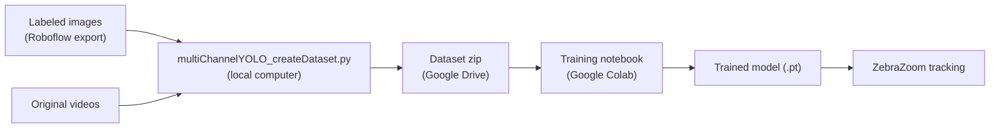

# Multi-channel (temporal) YOLO tracking with ZebraZoom

ZebraZoom's [deep learning based center of mass tracking](https://zebrazoom.org/documentation/docs/DLtracking/centerOfMassTracking/) normally gives the YOLO network one video frame at a time. In **multi-channel mode**, the network sees several frames at once: each image it receives is a stack of grayscale frames taken around the current frame **n**, one frame per channel. By default, these are frames **n−3**, **n** and **n+3**:

| Channel | Content (default frame offsets) |
|:-------:|---------------------------------|
| 1       | grayscale frame n − 3           |
| 2       | grayscale frame n               |
| 3       | grayscale frame n + 3           |

Since movement becomes visible to the network, it can find animals that are hard to see in a single frame (camouflaged, blurred, partly hidden) and ignore still objects that look like animals. Any set of frame offsets can be used, giving 2, 3, 5, 15 or more channels.

> [!NOTE]
> Color is not used: every frame is converted to grayscale.

## Contents

- [Overview](#overview)
- [1. Labeling images](#1-labeling-images)
- [2. Creating the multi-channel dataset](#2-creating-the-multi-channel-dataset)
- [3. Training on Google Colab](#3-training-on-google-colab)
- [4. Tracking with ZebraZoom](#4-tracking-with-zebrazoom)
- [Choosing frame offsets](#choosing-frame-offsets)
- [Troubleshooting](#troubleshooting)
- [How it works](#how-it-works)
- [Validation](#validation)

## Overview



1. **Label** images on Roboflow, as for standard YOLO tracking.
2. **Create** the multi-channel dataset on a computer that has the original videos.
3. **Train** the network on Google Colab.
4. **Track** with ZebraZoom, adding one parameter to the configuration file.

| File | Role |
|------|------|
| [multiChannelYOLO_createDataset.py](multiChannelYOLO_createDataset.py) | Builds the training dataset from the Roboflow export and the videos |
| [zebrazoomyolov11training_multiChannel.ipynb](zebrazoomyolov11training_multiChannel.ipynb) | Google Colab training notebook |
| [YOLO_centerOfMassTracking_multiChannel.json](YOLO_centerOfMassTracking_multiChannel.json) | Example ZebraZoom configuration file |
| [multiChannelYOLO.py](../zebrazoom/code/tracking/customTrackingImplementations/yolov11/multiChannelYOLO.py) | Multi-channel inference inside ZebraZoom |

## 1. Labeling images

Labeling works exactly as described in the [center of mass tracking documentation](https://zebrazoom.org/documentation/docs/DLtracking/centerOfMassTracking/): draw boxes around the animals on Roboflow. Multi-channel training adds three requirements.

**Image names must identify the video and the frame** each image comes from: `[videoName]_[frameNumber]`, for example `DSCF0081_1250.png`.
- Roboflow renames this image `DSCF0081_1250_png.rf.[hash].jpg` and replaces spaces and parentheses with `-`; the dataset script handles both.
- The frame number only needs to be roughly right: the script finds the exact frame by comparing pixels (see [How the labeled frames are found](#how-the-labeled-frames-are-found)).
- Images named `frame_[frameNumber]`, without the video name (as saved by [saveImages.py](saveImages.py)), can also be used. They need a folder containing one subfolder per video, named after the video, holding these images (option `--frameImagesBackupFolder`). A `-b`, `-c`, … and/or `.coco` suffix in subfolder names is ignored, so unzipped Roboflow COCO exports of several labeling batches can be used as they are. When the same frame number exists in several videos, all of them are searched and the best match is used.

**The Roboflow version must be generated without preprocessing or augmentation.** Augmentations are applied during training by the notebook, and flipped or rotated copies made by Roboflow can't be matched to video frames.

**The dataset must be downloaded in YOLOv11 format** to the computer that has the videos, either:
- from the Roboflow website: *Download Dataset* → *YOLOv11* → *Download zip to computer*, then unzip;
- or with the Python download code given by Roboflow (after `pip install roboflow`), which creates a folder such as `Cavefish-28`.

> [!IMPORTANT]
> The folder given to the script must directly contain `data.yaml`, `train/` and `valid/` (and `test/` if present). Unzipping tools sometimes add an extra folder level.

## 2. Creating the multi-channel dataset

The script is standalone: it only needs OpenCV, NumPy and PyYAML, all installed with ZebraZoom.

```bash
python DLrelatedFiles/multiChannelYOLO_createDataset.py --roboflowDataset path/to/Cavefish-28 --videoFolders path/to/videos1 path/to/videos2 --outputFolder path/to/multiChannelDataset --zip --imageSize 640 --workers 6
```

Add `--frameImagesBackupFolder path/to/frameImages` when some images are named `frame_[frameNumber]`.

| Option | Default | Description |
|--------|---------|-------------|
| `--roboflowDataset` | *required* | Folder of the Roboflow export in YOLOv11 format |
| `--videoFolders` | *required* | One or more folders containing the videos (subfolders are also searched) |
| `--outputFolder` | *required* | Where the dataset, zip, report and previews are written |
| `--frameOffsets` | `-3,3` | Frames added as channels, relative to the current frame, which is always included. Example: `--frameOffsets=-2,-1,1,2` (5 channels). The `=` is needed because the value starts with `-` |
| `--imageSize` | original size | Stores the images already resized (long side) for training, e.g. `640` for `imgsz=640`. Training images are identical, and the zip is about 4× smaller. `imgsz` must then not be larger |
| `--frameImagesBackupFolder` | none | Folder used to find the videos of images named `frame_[frameNumber]` (see [Labeling images](#1-labeling-images)) |
| `--zip` | off | Also creates a zip of the dataset, ready to upload to Google Drive |
| `--workers` | 4 | Number of videos processed in parallel |
| `--skipUnmatched` | off | Leaves out the images without video or with a doubtful match, instead of stopping |
| `--nbPreviews` | 20 | Number of preview images created for visual checks |

### What the script does

1. **Matching.** Each video that has labeled images is read entirely, frame by frame, exactly as ZebraZoom reads videos during tracking. Every labeled image is compared with every frame of its video. The frame number of the image name is kept unless another frame matches clearly better.
2. **Checks.** The script stops and lists the images concerned if a video can't be found, or if an image's best match is doubtful (not clearly closer than a typical frame of that video, meaning the image probably doesn't come from it).
3. **Writing.** Each labeled image becomes a multi-page TIFF image, one page per channel: page *i* is the grayscale frame *n + offset<sub>i</sub>*. Before the first frame or after the last frame of a video, the first or last frame is used instead. Labels are copied unchanged from the Roboflow export, and `data.yaml` records the number of channels and the frame offsets.

### How the labeled frames are found

Frame extraction tools that "jump" to a frame number (OpenCV's `CAP_PROP_POS_FRAMES`) can land on a different frame in some AVI files, while ZebraZoom reads videos frame by frame, which gives the true numbering. On a dataset of about 40 ten-minute videos, 14 of 1,092 labeled images, all from 5 AVI files, were off by 1 to 289 frames. These AVI files also contained fewer readable frames than announced in their header. For this reason, every labeled image is located by its content, and images whose frame number was corrected are listed at the end of the matching step.

### Output

```text
multiChannelDataset/
├── Cavefish-28_frames-3_0_+3_size640/            dataset: train/, valid/, data.yaml
├── Cavefish-28_frames-3_0_+3_size640.zip         the same dataset, zipped (--zip)
├── Cavefish-28_frames-3_0_+3_size640_report.csv  video and frame used for each image
├── Cavefish-28_frames-3_0_+3_size640_previews/   images for visual checks
└── frameMatchingCache.json                       matching results, reused by later runs
```

- **Report**: for each image, the video, the frame number in the name, the frame actually used, the match errors and a status (`ok`, `ok (frame number corrected)`, or the reason it was left out).
- **Previews**: for a random sample of images and for every corrected image, the Roboflow image, frames n−3, n and n+3 with the labels drawn, and a color composite in which moving animals appear in color. All panels should show the same scene, with boxes on the animals.
- **Final summary**: the number of images per split, the image size, and the full-resolution mean squared error between the labeled images and their current-frame channel. Because of Roboflow's JPEG compression, values of a few units are expected (median about 4 in tests).

### Runtime and size

- **First run:** about 30 minutes for about 40 ten-minute 1280×720 videos on an 8-core laptop with `--workers 6`, since every video is read entirely.
- **Later runs** reuse `frameMatchingCache.json` and take about 5–7 minutes. This includes runs with other frame offsets or another image size, and runs restarted after a stop (matching results are saved after each video). Only videos with new or modified labeled images are read again.
- **Zip size** for 1,092 images from 1280×720 videos: about 1 GB with 3 channels, about 1.8 GB with 5 channels, and about 320 MB with 3 channels and `--imageSize 640`.

## 3. Training on Google Colab

[](https://colab.research.google.com/github/oliviermirat/ZebraZoom/blob/master/DLrelatedFiles/zebrazoomyolov11training_multiChannel.ipynb)

1. Upload the zip created in step 2 to Google Drive.
2. Open the notebook in Colab (badge above, or *File* → *Upload notebook*).
3. Select a GPU: *Runtime* → *Change runtime type* → *T4 GPU* (or any other GPU).
4. In the **Parameters** cell, set `zipPathOnGoogleDrive` to the path of the zip, for example `/content/drive/MyDrive/Cavefish-28_frames-3_0_+3_size640.zip`.
5. *Runtime* → *Run all*, then allow access to Google Drive.

At the end, the trained model (for example `model_frames-3_0_+3_crossPlatform_compatible.pt`) is downloaded and also copied next to the zip on Google Drive. The notebook prints the lines to add to the ZebraZoom configuration file.

| Parameter | Default | Description |
|-----------|---------|-------------|
| `zipPathOnGoogleDrive` | — | Path of the dataset zip on Google Drive |
| `modelToStartFrom` | `yolo11n.pt` | Pretrained network. `yolo11s.pt`, `yolo11m.pt`, … are bigger: more accurate but slower |
| `epochs` | `1000` | Maximum number of epochs. Training usually stops earlier on its own (see below) |
| `imgsz` | `640` | Training image size. Must not be larger than `--imageSize` if that option was used |
| `brightnessGain` | `0.4` | Random brightness changes of ±40% |
| `averagePretrainedFirstConvOverChannels` | `True` | Initialization of the network's first layer (see [Augmentations and initialization](#augmentations-and-initialization)) |

### Stopping the training early

Ultralytics stops the training automatically after 100 epochs without improvement on the validation images. To stop it sooner (after at least one complete epoch):

1. Stop the training cell (■ button, or *Runtime* → *Interrupt execution*).
2. Skip the metrics cell, which needs a finished training.
3. Run the last two cells.

They save the best model reached so far, since `best.pt` is updated after every epoch that improves the validation results. The file is larger than after a complete training (about 25 MB instead of about 5 MB for `yolo11n`) because it still contains the training state; ZebraZoom uses it in the same way.

> [!WARNING]
> If Colab disconnects (idle timeout, usage limits), everything in `/content` is lost, including `best.pt`. For long trainings, add `project='/content/drive/MyDrive/yoloRuns',` to the `model.train(...)` arguments so that `best.pt` is also kept on Google Drive. After a disconnection, run all the cells before the **Training** cell, then the saving cell with `model.trainer.best` replaced by the path of that `best.pt`.

### Augmentations and initialization

Channels are video frames taken at different times, not colors, so every augmentation must treat all channels in the same way.

| Augmentation | Setting | Reason |
|--------------|---------|--------|
| Vertical and horizontal flips | probability 0.5 each | Spatial: identical on all channels |
| Mosaic, translation, scaling | Ultralytics defaults | Spatial: identical on all channels |
| Color changes (`hsv_h`, `hsv_s`, `hsv_v`) | disabled | Would mix the frames together |
| Albumentations (blur, median blur, to-gray, CLAHE) | disabled (`augmentations=[]`) | To-gray and CLAHE would also mix the frames of 3-channel images |
| Brightness | ±40%, same change on all channels | Replaces `hsv_v`, with the same effect on grayscale images |
| Channel order | never swapped (`bgr=0`) | The order of the frames carries the direction of time |

The pretrained network was trained on RGB images. With `averagePretrainedFirstConvOverChannels = True`, every channel of the first convolution starts from the pretrained filters summed over RGB and divided by the number of channels. On a still scene (all channels identical), the network then starts exactly like the pretrained network on a grayscale image. Ultralytics' default (used when this parameter is `False`) gives the RGB filters to the first three channels and random filters to the others.

## 4. Tracking with ZebraZoom

1. Place the trained `.pt` file in ZebraZoom's configuration folder, as for standard YOLO tracking.
2. Start from [YOLO_centerOfMassTracking_multiChannel.json](YOLO_centerOfMassTracking_multiChannel.json), or add these two lines to an existing `yolov11basedTracking` configuration file:

   ```json
   "DLmodelPath": "model_frames-3_0_+3_crossPlatform_compatible.pt",
   "yoloMultiChannelFrameOffsets": [-3, 3]
   ```

3. Launch the tracking as usual, from the GUI or the command line.

- `yoloMultiChannelFrameOffsets` must contain the offsets used to create the dataset. The current frame is added automatically: `[-3, 3]` and `[-3, 0, 3]` are equivalent.
- The model file stores the offsets it was trained with. ZebraZoom stops with an explicit error if they differ from the configuration file, or if a multi-channel model is used without `yoloMultiChannelFrameOffsets`.
- No new dependency is needed: multi-channel models run with the Ultralytics version installed with ZebraZoom.
- Everything downstream of the detections works as usual (`yolo11MinConf`, post-processing such as `OrTools`, …). Tracking speed should be essentially unchanged, since only the network's first layer takes more channels.
- Not supported: `trackTailWithYOLO` (ZebraZoom stops with an error), and end-to-end models without NMS (such as YOLOv10 or YOLO26). YOLO11 detection models are supported.

> [!IMPORTANT]
> Multi-channel tracking needs a ZebraZoom version that includes [multiChannelYOLO.py](../zebrazoom/code/tracking/customTrackingImplementations/yolov11/multiChannelYOLO.py) (versions after 1.34.98). An older version ignores `yoloMultiChannelFrameOffsets` and, with 3-channel models, gives wrong detections without any error. When running ZebraZoom from source, launch it from the repository folder; `python -c "import zebrazoom; print(zebrazoom.__file__)"` shows which copy of ZebraZoom is used.

## Choosing frame offsets

- The default `[-3, 3]` looks 0.1 s before and after the current frame at 30 frames per second.
- Larger offsets (for example `--frameOffsets=-10,10`) suit slow animals, which barely move in a few frames. More channels (for example `--frameOffsets=-6,-3,3,6`) show a longer stretch of movement.
- The same offsets must be used for the dataset, the training and the tracking. The dataset name, the model file name and the configuration lines printed by the notebook all include them.
- Trying other offsets costs a dataset rebuild (about 5–7 minutes, thanks to the cache) and a training.
- To compare models, look at tracking results on real videos in addition to validation mAP. mAP measures per-frame box accuracy on a few validation images, while the extra frames mostly help in hard cases (hidden or camouflaged animals, still objects that look like animals) that may be rare among them.

## Troubleshooting

| Message | Solution |
|---------|----------|
| `No images found in ... (expected subfolders such as train/images, valid/images)` | `--roboflowDataset` must point to the folder that directly contains `data.yaml`, `train/` and `valid/` |
| `No video found for N images` | Add the folder containing these videos to `--videoFolders`, or provide `--frameImagesBackupFolder` for `frame_[frameNumber]` images. `--skipUnmatched` leaves these images out |
| `N images whose best match in the video is doubtful` | These images probably don't come from the video found (or were modified by a Roboflow augmentation). Check them, or leave them out with `--skipUnmatched` |
| `This model was trained on multi-channel images: add "yoloMultiChannelFrameOffsets": ...` (ZebraZoom) | Add the line given in the message to the configuration file |
| `... doesn't match the frame offsets the model was trained with ...` (ZebraZoom) | Use the offsets printed by the notebook |
| `The model expects N channels but yoloMultiChannelFrameOffsets ... gives M channels` (ZebraZoom) | Use the offsets printed by the notebook |

## How it works

- **Dataset images** are LZW-compressed multi-page TIFF files: page *i* is channel *i*. Ultralytics reads them as one multi-channel image, with the number of channels given by `channels` in `data.yaml`.
- **Identical images in training and tracking.** The grayscale conversion and the stacking of frames use the same functions in the dataset script and in ZebraZoom (`getChannelOffsets`, `convertFrameToGrayscale`, `getStackFrameIndices`), which must stay identical. With `--imageSize`, images are resized exactly as Ultralytics does during training (long side, linear interpolation, whole stack at once).
- **In ZebraZoom**, when `yoloMultiChannelFrameOffsets` is set, `MultiChannelFrameReader` reads the video in place of `cv2.VideoCapture`. It returns the same frames and builds the stack of each frame, reading ahead the future frames it needs. The Ultralytics version installed with ZebraZoom can't run multi-channel models, so `MultiChannelYOLOPredictor` reproduces the Ultralytics 8.4 detection predictor: letterbox resizing, channel order, non-maximum suppression and box rescaling.
- **Without** `yoloMultiChannelFrameOffsets`, the tracking code path is unchanged.

## Validation

Tests were run on a mock Roboflow export with the same 1,092 file names as a real cavefish dataset (images re-encoded as JPEG, as Roboflow does), with about 40 videos:

- **Frame matching:** under JPEG compression, every image was matched to the same video and frame as with the lossless originals. With lossless images, every current-frame channel was pixel-identical to its labeled image.
- **Training and tracking images:** ZebraZoom builds stacks identical to the dataset's, checked on 25 real videos (MP4 and AVI) and, for the first and last frames, on a synthetic video.
- **Notebook:** all cells except the installation and Google Drive ones ran locally on CPU with Ultralytics 8.4.183, for 3 and 5 channels, including a training stopped early.
- **Inference:** ZebraZoom's predictor (with the Ultralytics version installed with ZebraZoom, 8.3.33) and Ultralytics 8.4.183's own predictor gave the same 23,199 boxes, within 0.02 px.
- **Existing tracking unchanged:** without the new parameter, an existing configuration (with `OrTools` post-processing) gave identical results before and after this feature was added (1,402 output datasets compared over 150 frames).
